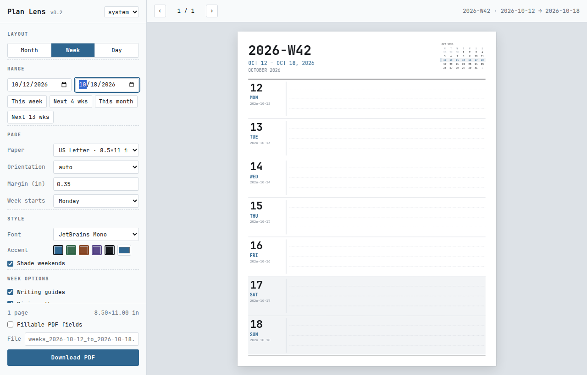

# Plan Lens

Offline, browser-based generator for printable calendar pages: **month**, **week**, or **day** per page, exported as PDF.
No install, no server, no network. Open `index.html` locally or host the folder as a static site.
Optional fillable fields let you type into the PDF in Chrome, Edge or Adobe Acrobat.



## Use

1. Open `index.html` (double-click works; `file://` is supported).
2. Pick a layout, set the date range, adjust paper / margins / options.
3. Page through the live preview (◀ ▶ or arrow keys).
4. Optionally tick **Fillable PDF fields**.
5. **Download PDF**.

Save frequent setups as **Presets** (kept in the browser's local storage). **Export JSON** backs up the current config and all presets. **Import JSON** restores them on another machine or browser.

## Layouts

| Layout | Default orientation | Contents |
|---|---|---|
| Month | landscape | ISO week gutter, weekend shading, carry-over days dimmed, prev/next mini months, notes strip |
| Week | portrait | ISO week label (`2026-W42`), date span, highlighted mini month, one row per day with writing guides |
| Day | portrait | Hourly schedule (configurable hours, optional second time zone), Top 3, task checkboxes, notes |

### Fillable PDF fields

Optional. Adds typeable text fields and checkboxes over every writing area: hour and half-hour slots, Top 3, tasks with checkboxes, notes and week rows (one single-line field per ruled line, so typed text sits on the rule), and month cells. Typed text uses JetBrains Mono. Target viewers are Chrome, Edge and Adobe Acrobat on Windows. Field names are built from the date (e.g. `2026-10-13_h0930`, `2026-10-13_task03_done`), so filled data can be exported later as structured records.

Fillable PDFs are about 1 MB larger because the full font is embedded (any character you type needs a glyph). The app warns above 120 pages, since very large forms open slowly.

### Page options

Paper: US Letter, A4, Half Letter, A5. Week starts Monday or Sunday. Font: JetBrains Mono (embedded) or Courier.

The second time zone uses the browser's built-in tz database (`Intl`). Offsets are computed per date, so DST changes are handled.

## Structure

```
index.html          UI shell + styles
js/dates.js         pure date math (UTC dates, ISO weeks, tz offsets) — no DOM
js/surfaces.js      drawing backends: CanvasSurface (preview) + PdfSurface (export), same API
js/render.js        page layouts + job planning — draws only through the surface API
js/forms.js         optional pass: pdf-lib adds form fields recorded during the jsPDF render
js/app.js           UI state, form binding, presets, preview paging, export
vendor/             jsPDF 4.2.1, pdf-lib 1.17.1, @pdf-lib/fontkit 1.1.1 (all MIT), vendored for offline use
fonts/              JetBrains Mono (OFL 1.1) as base64, so file:// works without fetch
docs/               README assets
```

Design rules:
- **One layout, two outputs.** Renderers call `text / line / rect` on a surface and never touch canvas or jsPDF directly. The preview and the PDF come from the same code, so they can't drift apart.
- **Plan, then draw.** `planJobs(config)` decides which pages exist; `renderJob()` draws one page. A new page type is one render function plus one branch in `planJobs`.
- **Classic scripts, not ES modules.** Browsers block module imports over `file://`. Each file attaches to the `window.PL` namespace instead.
- **Fields are recorded, not drawn.** Renderers call `s.field(...)` for every writable area. The preview outlines them, the PDF surface records them, and `forms.js` adds them in a second pass with pdf-lib, because jsPDF's own form support is incomplete. With Fillable off, that pass never runs.
- **Config is the single source of truth.** Form changes write to `cfg`, and everything else is recomputed from it. That is also what presets and JSON export serialize.

## Hosting

Static files with relative paths, so any static host works.

**GitHub Pages:** push to GitHub → *Settings → Pages → Deploy from a branch → `main` / root*. `.nojekyll` is included so files are served as-is.

**GitLab Pages:** push to GitLab. The included `.gitlab-ci.yml` copies the app into `public/` and deploys it on the default branch.

## License

Apache-2.0 © pearmanref. Bundled third-party: jsPDF (MIT, `vendor/jspdf.LICENSE`), pdf-lib (MIT, `vendor/pdf-lib.LICENSE.md`), @pdf-lib/fontkit (MIT), JetBrains Mono (SIL OFL 1.1, `fonts/OFL.txt`).
